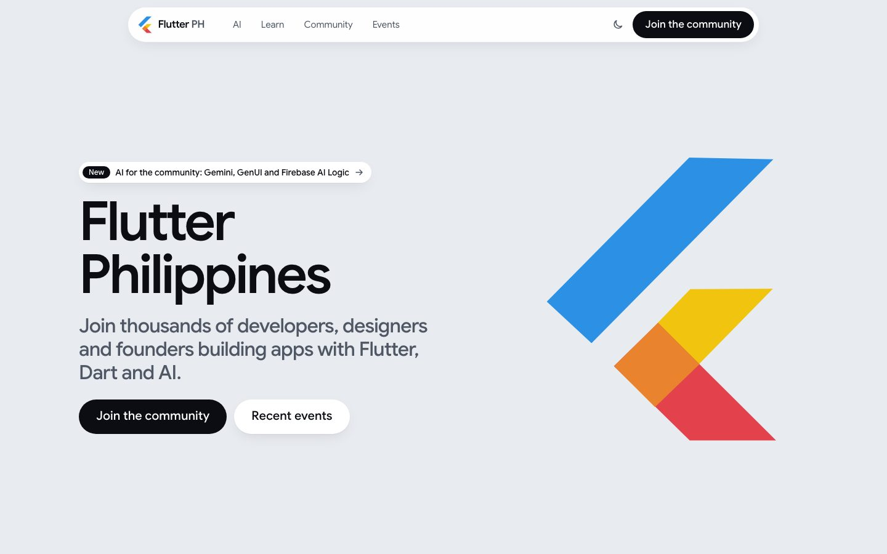
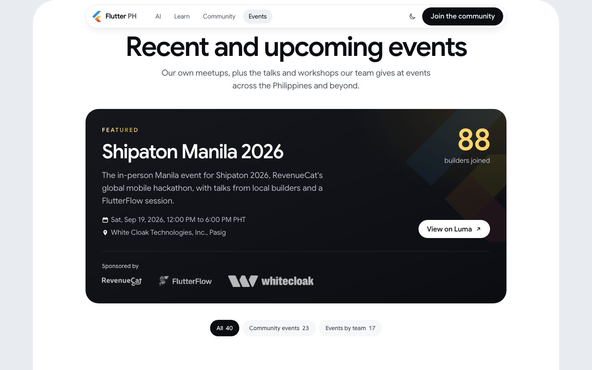
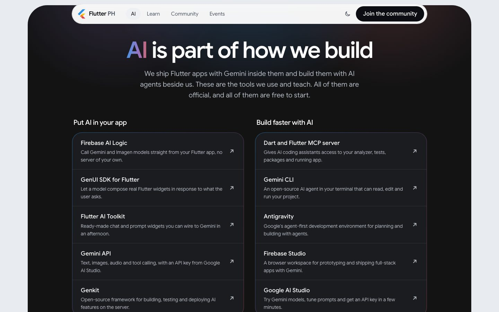

# Flutter Philippines

The website of [Flutter Philippines](https://flutter.ph), a community of designers, developers and founders building apps with Flutter, Dart and AI. Founded in Manila in 2019.



<table>
  <tr>
    <td width="72%"></td>
    <td width="28%"></td>
  </tr>
  <tr>
    <td></td>
    <td></td>
  </tr>
</table>

## What's here

- **Home:** what the community is, where it started, the AI tools we teach, how to join, and every event we have run or spoken at.
- **Events:** community meetups (from Luma and the old Meetup group) plus talks, workshops and open-source demos by the team. Upcoming and past are worked out from the date in Manila time, and the site rebuilds daily so events roll over on their own.
- **Content as files:** events, talks, people and partners live in `content/` as small MDX or YAML files. Anyone can add one with a pull request. See [CONTRIBUTING.md](CONTRIBUTING.md).

## Why Next.js and not Flutter web

The old site was a Flutter web app. Flutter web is great for apps, but a community site needs to be found on Google, shared on Facebook with a proper preview, readable by screen readers, and fast on a mid-range phone on mobile data. Those need real HTML on first load. This site is built with Next.js and exported as plain static files, so it loads instantly and costs nothing to host on GitHub Pages. We still show off Flutter through the people, talks and apps on the site.

## Run it locally

You need Node 24 (`nvm use` reads `.nvmrc`) and pnpm via Corepack.

```bash
corepack enable
pnpm install
pnpm dev          # http://localhost:3000
```

To try it on your phone, run `pnpm dev -H 0.0.0.0` and open `http://<your computer's LAN IP>:3000` on the same Wi-Fi.

## Test it

| Command                    | What it does                                                                                 |
| -------------------------- | -------------------------------------------------------------------------------------------- |
| `pnpm build && pnpm start` | Production build in `out/`, served the way GitHub Pages serves it                            |
| `pnpm build:preview`       | Same, but includes sample content                                                            |
| `pnpm test`                | Unit tests (dates, visibility rules)                                                         |
| `pnpm test:e2e`            | Accessibility (axe) in light and dark, legacy URLs, at 360 to 1440 px in Chromium and WebKit |
| `pnpm test:perf`           | Scroll smoothness in Chromium and WebKit, fails on jank or layout shift                      |
| `pnpm lighthouse`          | Lighthouse mobile against the production build, 95+ budgets                                  |
| `pnpm check`               | Everything above that CI runs on every pull request                                          |

Run `pnpm build` (or `pnpm build:preview`) before `pnpm test:e2e` and `pnpm test:perf`.

## How it's built

- Next.js 16 App Router with React Server Components, exported as static files (`output: "export"`)
- TypeScript (strict), Tailwind CSS 4 with design tokens in `src/app/globals.css`
- Content Collections with Zod schemas in `content-collections.ts`: a wrong date or a missing alt text fails the build with a readable message
- Google Sans and Google Sans Code (SIL Open Font License), self-hosted
- Motion is CSS scroll-driven animation, transform-only, and switches off with reduced motion
- About 3 KB of our own JavaScript on top of the framework

## Deploy

Pushes to `master` build and publish to GitHub Pages through `.github/workflows/deploy.yml`, which also runs daily at midnight Manila time. One-time setup by a maintainer: **Settings > Pages > Source = GitHub Actions**, and the custom domain `flutter.ph`.

Analytics is off unless the repository variable `GA_MEASUREMENT_ID` is set to a Google Analytics 4 ID (`G-...`).

Old links such as `/join`, `/ask`, `/meetups/3` and `/webinars/1` still work.

## Brand

Flutter and the related logo are trademarks of Google LLC. Flutter Philippines is a community-run group and is not endorsed by or affiliated with Google LLC. Our logo is the Flutter logo in Philippine flag colors, as the Flutter brand guidelines allow for local user groups.

## License

BSD 3-Clause. See [LICENSE](LICENSE).
